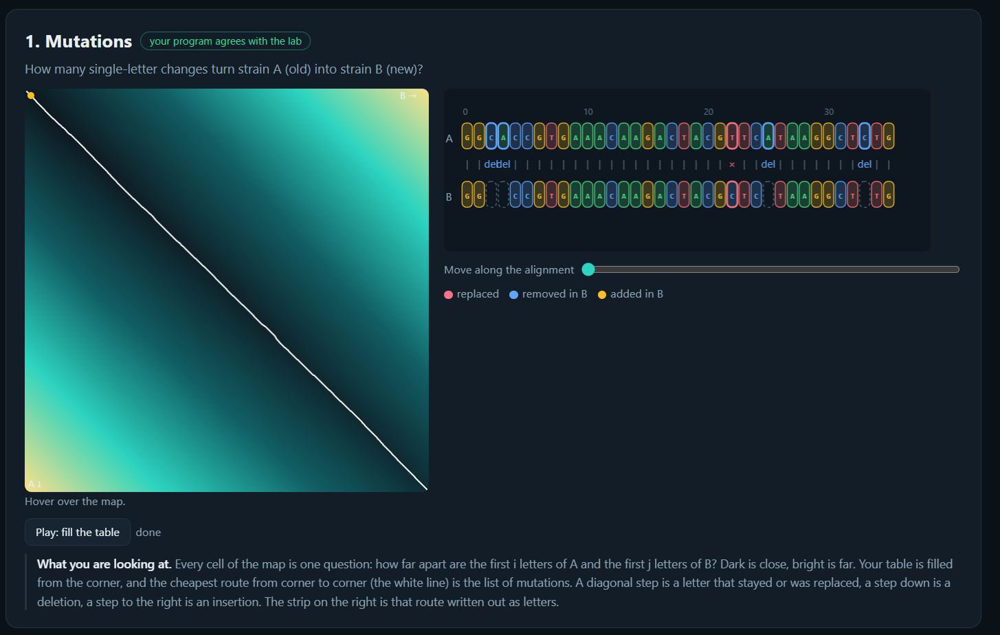
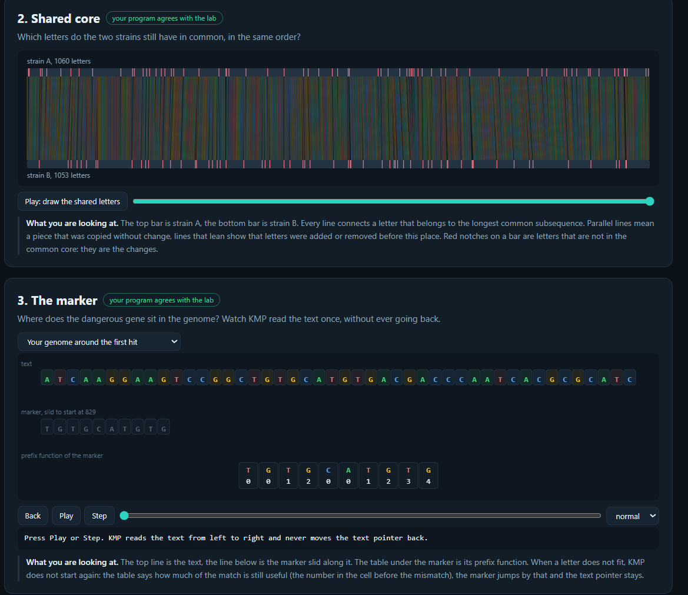
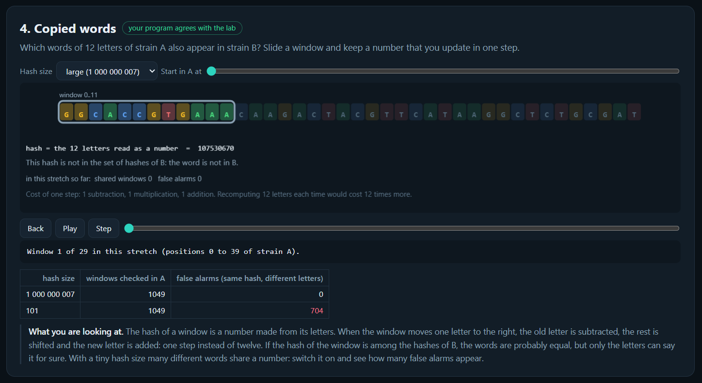
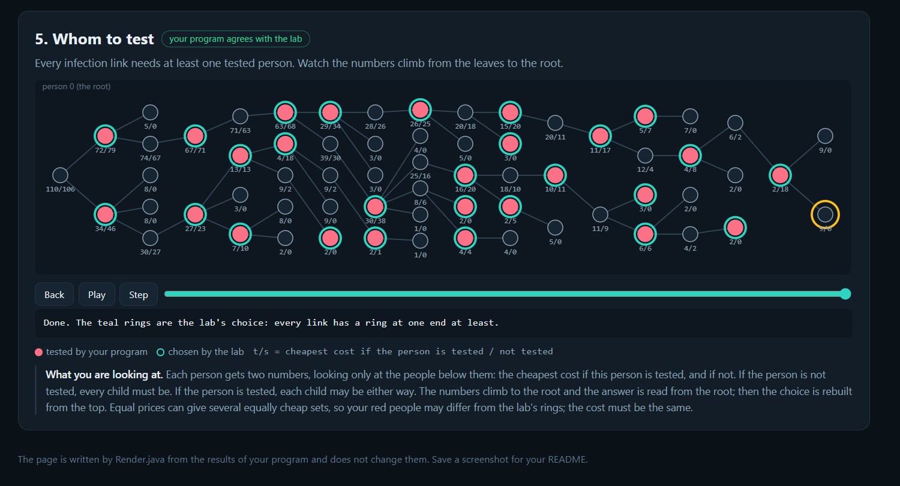

# Assignment 4. Patient Zero

Student ID: 252881
Name: Danial Bolatov
Group: SE-2519

This file is the report. Fill it in as you go. How to start: `START_HERE.md`. The task: `docs/Assignment4.pdf`.

## Program output

The 9 lines your program prints on your data (`java -cp out Main`):

    Mutations: 100
    Shared core: 990
    Marker hits: 6
    First hit: 845
    Border length: 4
    Shared words: 345
    Tests needed: 26
    Cheapest testing: 106
    Longest chain: 25

My outbreak report (a screenshot of `output/outbreak.html`):

## Questions

Answer in your own words, two or three sentences each.

Mission 1. What does the cell d[i][j] of your table mean, and how is it computed from other cells?
>    It represents the minimum edit distance required to transform first 'i' characters of 'a' into the first characters 'j' of 'b';
    It is computed by taking the minimum of delition, insertion or substition. 

Mission 2. How is the longest common subsequence different from the longest common substring? My Shared core is bigger than the number of letters that are the same at the same place: why?
>    Characters are allowed to be non-consecutive as long as they appear in the same relative order
    Althogh, a longest common substring requires characters to be continuous.

Mission 3. What does the prefix function tell you, and why does the pointer in the text never go back in KMP? What is the Border length of my marker and what does it mean?
>    The prefix function stores the length of the longest proper prefix that is also a suffix, thus representing maximum overlapping borders.
    Text never goes back in KMP because the pattern pointer 'j' shifts backward using the prefix array 'pi[j-1]', and search continues without rescanning text
    
Mission 4. Why must you compare the letters after the hashes are equal? What happens to the cost of Rabin-Karp if many windows have the same hash?
>    Because different substrings can have identical hash values and not verifying can lead to issues
    If many windows have the same value, it can lead to performance issues
    
Mission 5. What are the two states of a person in your DP, and how do you get the answer for a person from its children? Why does a greedy "test the person with most links first" not always give the cheapest answer?
>   Two states are the person being tested or not
>   To find the value from children, if a person is tested: the cost is their own test + minimum cost of each child
>   If a person isn't tested, their children must be tested 

## AI use
AI (ChatGPT) was used in this task to help with the understanding of algorithm and also help with code structure. 
It also checked code for errors and helped me to solve them.
I didn't take code from any other site. 

The syllabus requires you to say which AI tools you used and for what. Write the tool (ChatGPT, Copilot, other) and what you asked it: explain an idea, find an error, review code. Write "none" if you did not use any. If you took code or text from a book or a website, give the source here.

## Timing (Mission 7)

Milliseconds, average of 3 runs, from `java -cp out Bench`.

| test          | size   | time (ms) |
|---------------|--------|-----------|
| naive search  | 20 000 | 103.6 ms  |
| naive search  | 40 000 | 194.8 ms  |
| naive search  | 80 000 | 366.0 ms  |
| KMP           | 20 000 | 7.5 ms    |
| KMP           | 40 000 | 4.4 ms    |
| KMP           | 80 000 | 0.8 ms    |
| edit distance | 500    | 12.4 ms   |
| edit distance | 1000   | 13.0 ms   |
| edit distance | 2000   | 34.0 ms   |
| edit distance | 4000   | 158.4 ms  |

## Complexity

n is the length of the text (or of a strain), m the length of the pattern, k the length of the window, v the number of people. Fill in every algorithm you wrote.

| algorithm | time   | space  | assumptions |
|---|--------|--------|---|
| Edit distance | O(n*m) | O(n*m) | |
| LCS | O(n*m) | O(n*m) | |
| Prefix function and KMP | O(n+m) | O(m)   | |
| Rabin-Karp (shared words) |        |        | |
| Tree DP |        |        | |

## Before you submit

- The four files in `data` and the screenshot `output/outbreak.png` are in the repository.
- `java tools/Check.java` shows all examples right.
- This README is filled in, the program output and the section AI use included.
- The work is pushed to main (at least one commit per mission) and the repository is public.
- The link is attached in Moodle.
